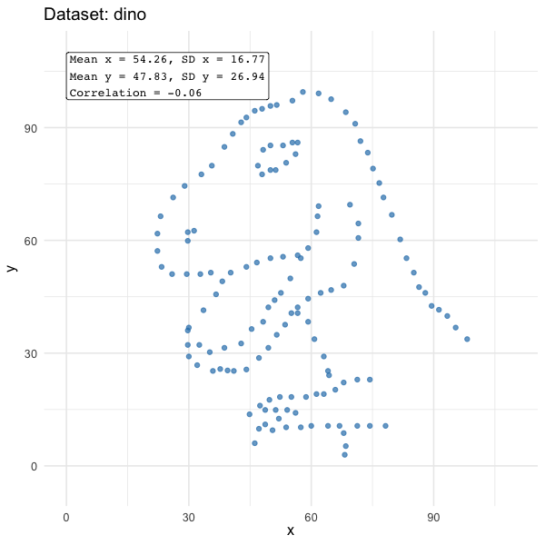

# Principles of data visualization

```{r}
#| include: false

# settings, placed in a chunk that will not show in the .html file (because include=FALSE)

# hide messages and warnings from the rendered .html file
knitr::opts_chunk$set(message = FALSE,
                      warning = FALSE)

# disables scientific notation so that small numbers appear as eg "0.00001" rather than "1e-05"
options(scipen = 999)

```

Data visualization is a large field. It has its own research literature on how people perceive and understand plots, and several excellent book-length treatments of how to make good ones. This chapter is not a substitute for them. It is a brief tour of the principles that matter most when you plot data from your own research, summarized from four sources that are well worth reading in full. The next chapter, [Plotting data with ggplot2](18_plotting_with_ggplot2.qmd), covers how to make plots in R.

::: {.callout-note title="The bad plots in this chapter are based on real ones"}
Many of the examples of bad plots in this chapter recreate, with made-up data, real plots that appeared in published articles, in the news, and elsewhere. The originals aren't shown because of licensing complications. So if some of the examples seem absurd, bear in mind that most of them are inspired by real life.
:::

## Sources

-   *Fundamentals of Data Visualization* by Claus Wilke [@wilke2019], freely available at [clauswilke.com/dataviz](https://clauswilke.com/dataviz/). A practical guide to which type of plot to use for which purpose, and how to make plots clear and accurate. Its second part, on the principles of figure design, is especially useful.
-   *Data Visualization: A Practical Introduction* by Kieran Healy [@healy2018], freely available at [socviz.co](https://socviz.co/). Its first chapter, [Look at data](https://socviz.co/01-look-at-data.html), is an excellent introduction to what makes figures good or bad, and to how visual perception works. The rest of the book teaches {ggplot2}. The website now hosts a draft of the book's second edition, so the links below point to it.
-   *The science of visual data communication: What works* by Steven Franconeri and colleagues [@franconeri2021]. A review of the research on how people read plots, written for a general audience. Its summary of key guidelines (p. 150) is a useful checklist.
-   *Saloni's guide to data visualization* by Saloni Dattani [@dattani2025], freely available at [scientificdiscovery.dev](https://www.scientificdiscovery.dev/p/salonis-guide-to-data-visualization). Practical advice from a researcher who made many widely shared charts for *Our World in Data*, illustrated with before-and-after redesigns of her own charts.

The code for the example plots in this chapter is folded away, because {ggplot2} is only introduced in the next chapter. Click "Show the code" to see it.

```{r}
library(dplyr) # for %>%, mutate(), group_by(), summarize()
library(tidyr) # for pivot_longer(), expand_grid()
library(forcats) # for fct_reorder(), fct_inorder(), fct_rev()
library(janitor) # for round_half_up()
library(ggplot2) # for plotting
library(patchwork) # for combining plots
library(scales) # for hue_pal(), ggplot2's default color palette
library(viridisLite) # for the viridis color palettes
library(colorspace) # for desaturate() and deutan(), to show how colors look in greyscale and to people with color vision deficiency
library(datasauRus) # for the datasaurus_dozen data
```

## Why plot data?

Summary statistics aren't enough. The 'Datasaurus Dozen' datasets [@matejka2017] all have nearly identical means, standard deviations, and correlations:

```{r}
# means and SDs
datasaurus_dozen %>%
  group_by(dataset) %>%
  summarize(mean_x = mean(x),
            sd_x = sd(x),
            mean_y = mean(y),
            sd_y = sd(y),
            correlation = cor(x, y)) %>%
  mutate(across(where(is.numeric), ~ round_half_up(.x, digits = 2)))
```

But when you plot them, the underlying data is very different. The animation below moves through each of the 13 datasets in turn. The summary statistics in the top left barely change, while the data takes very different shapes:

{fig-alt="An animated scatter plot that morphs between 13 datasets, including a dinosaur, a star, a bullseye, circles, and horizontal and vertical lines. A box in the top left shows that the means, standard deviations, and correlation of x and y stay almost identical throughout." width="80%"}

The animation was made with the {gganimate} package. It is saved as a file and shown as an image, rather than created each time this chapter is rendered, because creating it takes a while. You don't need to learn {gganimate} for this course, but the code is below if you're interested. It needs the {gganimate} and {gifski} packages to be installed.

```{r}
#| eval: false
#| code-fold: true
#| code-summary: "Show the code to create the animation"
library(dplyr)
library(ggplot2)
library(datasauRus)
library(gganimate)
library(janitor)
library(forcats)

# start the animation with the dinosaur
dat_datasaurus <- datasaurus_dozen %>%
  mutate(dataset = fct_relevel(dataset, "dino"))

# summary statistics for each dataset, formatted as a label
dat_datasaurus_labels <- dat_datasaurus %>%
  group_by(dataset) %>%
  summarize(mean_x = mean(x),
            sd_x = sd(x),
            mean_y = mean(y),
            sd_y = sd(y),
            r = cor(x, y)) %>%
  mutate(across(where(is.numeric), ~ format(round_half_up(.x, digits = 2), nsmall = 2)),
         label = paste0("Mean x = ", mean_x, ", SD x = ", sd_x, "\n",
                        "Mean y = ", mean_y, ", SD y = ", sd_y, "\n",
                        "Correlation = ", r))

plot_datasaurus <- 
  ggplot(dat_datasaurus, aes(x = x, y = y)) +
  geom_point(size = 2, alpha = 0.7, color = "#2c7fb8") +
  geom_label(data = dat_datasaurus_labels, 
             aes(x = 0, y = 110, label = label),
             hjust = 0, vjust = 1, size = 4.5, family = "mono") +
  coord_cartesian(xlim = c(0, 110), ylim = c(-5, 110)) +
  theme_minimal(base_size = 16) +
  labs(title = "Dataset: {closest_state}") +
  # animate the transitions between the datasets
  transition_states(dataset, 
                    transition_length = 2, 
                    state_length = 3) +
  ease_aes("cubic-in-out")

animation_datasaurus <- animate(plot_datasaurus, 
                                nframes = 260, 
                                fps = 20, 
                                width = 600, 
                                height = 600,
                                renderer = gifski_renderer())

anim_save("../images/datasaurus.gif", animation = animation_datasaurus)
```

Always plot your data [@franconeri2021, pp. 112-113; @healy2018] (see also Healy's section [Why look at data?](https://socviz.co/01-look-at-data.html#why-look-at-data)). Even if a plot is only used as an exploratory check of your data and analyses, and only appears in your supplementary materials, it should be part of your data analysis process. Plots often reveal problems that summary statistics hide, such as impossible values, outliers, ceiling effects, or errors in data processing. Saloni Dattani describes how plotting her data revealed an error in her own thesis [@dattani2025].

## What makes a figure bad?

Two useful ways of thinking about what goes wrong in figures:

-   Wilke labels problem figures as [ugly, bad, or wrong](https://clauswilke.com/dataviz/introduction.html#ugly-bad-and-wrong-figures). An *ugly* figure is unattractive, but still clear and informative. A *bad* figure has a problem with perception: it is unclear, confusing, overly complicated, or misleading. A *wrong* figure has a mathematical problem: it is objectively incorrect, e.g., because the size of a shape doesn't match the value it represents. Ugly is a matter of taste, but bad and wrong figures mislead readers.
-   Healy similarly distinguishes [three kinds of problems](https://socviz.co/01-look-at-data.html#what-makes-bad-figures-bad): bad taste, bad data, and bad perception. These often occur together, but each needs a different fix. Bad data is the easiest to overlook: a beautifully designed chart can still mislead if it shows a cherry-picked or inappropriate measure, and a polished design can even make a misleading chart more convincing ([Bad data](https://socviz.co/01-look-at-data.html#bad-data)).

The plots below show the same data four ways: the percentage of participants in a survey who used each of six social media platforms. Participants could use more than one platform.

```{r}
#| code-fold: true
#| code-summary: "Show the code"
#| fig-width: 10
#| fig-height: 8
dat_platforms <- tibble(platform = c("WhatsApp", "YouTube", "Instagram", "TikTok", "Facebook", "X"),
                        percent = c(92, 85, 78, 61, 34, 22))

plot_good <- ggplot(dat_platforms, aes(x = percent, y = fct_reorder(platform, percent))) +
  geom_col(fill = "grey40", width = 0.7) +
  geom_text(aes(label = paste0(percent, "%")), hjust = -0.15, size = 3.5) +
  scale_x_continuous(limits = c(0, 105), breaks = seq(0, 100, 25), 
                     labels = function(x) paste0(x, "%"), expand = c(0, 0)) +
  labs(title = "Good", 
       subtitle = "Most participants used WhatsApp\nand YouTube; few used X",
       x = "Participants who used the platform", y = NULL) +
  theme_classic()

plot_ugly <- ggplot(dat_platforms, aes(x = percent, y = fct_reorder(platform, percent), fill = platform)) +
  geom_col(width = 0.7, color = "black", linewidth = 1.2) +
  geom_text(aes(label = paste0(percent, "%")), hjust = -0.15, size = 3.5, 
            fontface = "bold.italic", color = "darkblue") +
  scale_fill_manual(values = rainbow(6)) +
  scale_x_continuous(limits = c(0, 105), breaks = seq(0, 100, 25), 
                     labels = function(x) paste0(x, "%"), expand = c(0, 0)) +
  labs(title = "UGLY!!!", subtitle = "SOCIAL MEDIA USE!!!", 
       x = "PARTICIPANTS WHO USED THE PLATFORM", y = NULL) +
  guides(fill = "none") +
  theme(plot.background = element_rect(fill = "yellow"),
        panel.background = element_rect(fill = "hotpink"),
        panel.grid.major = element_line(color = "black", linewidth = 1),
        panel.grid.minor = element_line(color = "white", linewidth = 0.8, linetype = "dotted"),
        plot.title = element_text(size = 20, face = "bold.italic", color = "red"),
        plot.subtitle = element_text(face = "bold", color = "purple"),
        axis.text = element_text(face = "italic", color = "darkgreen"))

plot_bad <- ggplot(dat_platforms, aes(x = platform, y = percent, fill = platform)) +
  geom_col() +
  scale_fill_brewer(palette = "Blues") +
  labs(title = "Bad", x = NULL, y = "%", fill = NULL) +
  theme_minimal() +
  theme(axis.text.x = element_blank(), 
        panel.grid = element_blank())

plot_wrong <- ggplot(dat_platforms, aes(x = 1, y = percent, fill = fct_reorder(platform, percent, .desc = TRUE))) +
  geom_col(color = "white", width = 1) +
  # labels placed outside the pie
  geom_text(aes(x = 1.75, label = paste0(platform, "\n", percent, "%")), 
            position = position_stack(vjust = 0.5), size = 3) +
  coord_polar(theta = "y") +
  xlim(0.5, 2) +
  scale_fill_brewer(palette = "Set2") +
  guides(fill = "none") +
  labs(title = "Wrong", x = NULL, y = NULL) +
  theme_void()

(plot_good + plot_ugly) / (plot_bad + plot_wrong)
```

-   **Good.** The platforms are sorted by how many participants used them, each bar is labeled with its value, the axis runs from 0% to 100%, and the title states the main finding.
-   **Ugly.** The data and layout are the same as the good plot, and it is still accurate and can still be read. But the clashing colors, heavy grid lines, and shouting text are unpleasant and distract from the data. Notice that some value labels are hard to read against the grid lines: this is where ugly starts to become bad.
-   **Bad.** The plot is accurate, but hard to read. The platforms are in alphabetical order, so the bars' heights are hard to compare. The bars can only be identified by matching their colors to the legend, and the colors are similar shades of blue, which also suggest an order that the platforms don't have. There are no value labels, and the axis title ("%") doesn't say what the percentages are.
-   **Wrong.** A pie chart shows parts of a whole, so it implies that each platform's slice is its share of 100%. But participants could use more than one platform, so the percentages add up to 372%. WhatsApp, used by 92% of participants, is shown as about a quarter of the pie.

Much of the rest of this chapter is about avoiding bad and wrong figures. Ugly figures matter less, but an ugly enough design starts to get in the way of perception too.

## Start from the question

Before choosing a type of plot, decide what question it should answer, and therefore which comparison readers need to make. Dattani shows how the same data on causes of death can be plotted as numbers of deaths, death rates, or shares of all deaths, and each answers a different question [@dattani2025] (see see her post [Four charts to understand causes of death](https://www.scientificdiscovery.dev/p/four-charts-to-understand-causes)).

This matters because readers can't take in every comparison a plot makes possible. Viewers extract broad summaries of a plot, such as its highest and lowest values and its overall trend, almost instantly. But comparing specific values is slow, and only a few such comparisons can be made per second. A plot with only four bars already allows six pairwise comparisons [@franconeri2021, pp. 122-124]. Readers will not make all of them, so you need to make the important one easy.

How the data is arranged determines which comparisons are easy. Values that are connected by lines, placed close together, or drawn in the same color are seen as belonging together, and are compared with each other [@franconeri2021, pp. 124-126]. Healy describes these as [gestalt rules](https://socviz.co/01-look-at-data.html#gestalt-rules) of perception. So put the values you want readers to compare next to each other, or connect them.

For example, imagine a small study in which 12 participants' anxiety was measured before and after an intervention. Most participants improved, but a few got worse. The plot on the left makes it easy to compare the two time points for each participant, but very hard to see which participants got worse. The plot on the right connects each participant's two scores with a line, highlights those who got worse, and states the finding in the title:

```{r}
#| code-fold: true
#| code-summary: "Show the code"
#| fig-width: 10
#| fig-height: 4.5
set.seed(42)

dat_prepost <- tibble(id = factor(1:12),
                      pre = round(rnorm(12, mean = 30, sd = 5)),
                      change = round(c(rnorm(9, mean = -6, sd = 2), rnorm(3, mean = 4, sd = 1)))) %>%
  mutate(post = pre + change,
         direction = if_else(post > pre, "Got worse", "Improved")) %>%
  pivot_longer(cols = c(pre, post),
               names_to = "timepoint",
               values_to = "anxiety") %>%
  mutate(timepoint = factor(timepoint, levels = c("pre", "post"), labels = c("Pre", "Post")))

plot_bad <- ggplot(dat_prepost, aes(x = id, y = anxiety, fill = timepoint)) +
  geom_col(position = position_dodge()) +
  scale_fill_manual(values = c("grey60", "grey20")) +
  labs(title = "Anxiety scores",
       x = "Participant", 
       y = "Anxiety",
       fill = "Time point") +
  theme_classic()

plot_good <- ggplot(dat_prepost, aes(x = timepoint, y = anxiety, group = id, color = direction)) +
  geom_line(linewidth = 1) +
  geom_point(size = 2) +
  scale_color_manual(values = c("Got worse" = "#D55E00", "Improved" = "grey70")) +
  annotate(geom = "text", x = 2.08, y = 41, label = "3 participants\ngot worse", 
           hjust = 0, color = "#D55E00") +
  coord_cartesian(xlim = c(1.2, 2.4)) +
  labs(title = "Most participants' anxiety fell,\nbut 3 got worse",
       x = "Time point", 
       y = "Anxiety") +
  guides(color = "none") +
  theme_classic()

plot_bad + plot_good
```

## Use position for the most important comparisons

Data can be represented using different visual properties, or channels, such as position, length, angle, area, and color intensity. People judge some of these much more precisely than others. Experiments that asked people to judge the ratio between two values found that, from most to least precise, people judge: position along a common scale, length, angle, area, and finally color intensity [@franconeri2021, pp. 113-116] (see Healy's section [Visual tasks and decoding graphs](https://socviz.co/01-look-at-data.html#visual-tasks-and-decoding-graphs)). So the most important values in a plot are best shown as positions along a common axis, e.g., as points or the ends of bars.

This explains several common recommendations:

-   **Bars and dots are easier to compare than pies.** Pie charts encode values as angles and areas, which are judged less precisely. Wilke argues that pie charts can work for showing simple fractions of a single whole, e.g., a half or a quarter, but that side-by-side bars are better for comparing many parts or several wholes ([Visualizing proportions](https://clauswilke.com/dataviz/visualizing-proportions.html#a-case-for-pie-charts)). Healy is more blunt ([Saying no to pie](https://socviz.co/08-polishing.html#saying-no-to-pie)).
-   **In stacked bar charts, only the bottom segment and the total are easy to compare.** The other segments don't start from a common baseline, so they can only be compared by their length [@franconeri2021, p. 116] (see Healy's section [Bad perception](https://socviz.co/01-look-at-data.html#bad-perception)). Wilke recommends stacking bars only when the total is meaningful in itself ([Visualizing amounts](https://clauswilke.com/dataviz/visualizing-amounts.html#grouped-and-stacked-bars)).
-   **Avoid 3D effects.** Tilted pies and 3D bars distort the values they show, because perspective changes their apparent sizes [@franconeri2021, p. 118]. Wilke calls gratuitous 3D unequivocally bad ([Don't go 3D](https://clauswilke.com/dataviz/no-3d.html#avoid-gratuitous-3d)), and Healy shows how a 3D bar chart can make every bar look lower than its true value ([Bad perception](https://socviz.co/01-look-at-data.html#bad-perception)).
-   **Size the area, not the width.** When a value is shown by the size of a shape, such as a circle or an icon, people perceive its area. If a circle's diameter is doubled, its area quadruples, so the difference looks much larger than it is [@franconeri2021, pp. 117-118]. Map values to the area of shapes, or better, use position.

Which channel is best also depends on the task. For example, color intensity, as in a heat map, can be better than position for judging the average of many values at once [@franconeri2021, pp. 120-121]. Healy and Wilke also recommend matching the channel to the type of data: position, length, and color lightness suit ordered data, whereas hue and shape suit unordered categories ([Channels for representing data](https://socviz.co/01-look-at-data.html#channels-for-representing-data)).

## Axes and baselines

Should the y axis start at zero? 'Always start the y axis at zero' is common advice, but it is too simple. The answer depends on the type of plot, and on whether zero is a meaningful reference point for the question the plot is meant to answer.

-   **Bars show values as lengths from a baseline.** Readers compare the lengths of the bars, so the lengths should be proportional to the quantities being compared. If a bar chart's axis is truncated, the lengths no longer reflect the values. This is the principle of proportional ink: the amount of ink used to show a value should be proportional to that value. The principle was named by Bergstrom and West [-@bergstrom2016] in their article [The principle of proportional ink](https://callingbullshit.org/tools/tools_proportional_ink.html), and Wilke devotes a chapter to it ([The principle of proportional ink](https://clauswilke.com/dataviz/proportional-ink.html)). Truncated axes make differences look larger, and in experiments this persisted even when viewers were warned about the truncation [@franconeri2021, pp. 116-117].
-   **This only makes sense when the baseline is meaningful.** Bars that start at zero suit quantities for which zero is a natural reference point, and where the question is about their size relative to it, e.g., counts, proportions, or amounts of time or money. But many variables in psychology have no meaningful zero. For example, scores on a Likert scale that runs from 1 to 7 can't be zero. And often the question is about the differences between groups or conditions, not about how large each one is relative to zero. Bars that start at zero then imply a baseline that means nothing, and can make meaningful differences hard to see. Some variables have a meaningful reference point other than zero, such as a scale's midpoint, or the value that indicates no effect (e.g., 0.5 for the AMP in the next chapter), and bars could start there instead. When no baseline is meaningful, bars are usually the wrong choice: use points instead, rather than truncating the bars.
-   **Points and lines don't need a baseline.** They represent values by their position alone, so their axis range can be chosen to fit the question (Healy's section [Problems of honesty and good judgment](https://socviz.co/01-look-at-data.html#problems-of-honesty-and-good-judgment); Wilke's [Dot plots and heatmaps](https://clauswilke.com/dataviz/visualizing-amounts.html#dot-plots-and-heatmaps)). For example, the full range of a scale shows where scores fall on it, whereas a narrower range shows the differences between groups more clearly, but also makes them look larger. Dattani suggests leaving some space around the range of the data, rather than zooming in as far as possible [@dattani2025].

```{r}
#| code-fold: true
#| code-summary: "Show the code"
#| fig-width: 10
#| fig-height: 3.5
set.seed(42)

dat_wellbeing <- tibble(condition = rep(c("Control", "Intervention A", "Intervention B"), each = 50),
                        wellbeing = c(rnorm(50, 4.4, 1), rnorm(50, 4.6, 1), rnorm(50, 4.9, 1))) %>%
  mutate(wellbeing = pmin(pmax(wellbeing, 1), 7)) # keep scores within the 1-7 scale

plot_truncated <- ggplot(dat_wellbeing, aes(x = condition, y = wellbeing)) +
  stat_summary(fun = mean, geom = "bar", fill = "grey60") +
  coord_cartesian(ylim = c(4.2, 5)) +
  labs(title = "Bad: truncated bars\nexaggerate the differences", x = NULL, y = "Mean wellbeing (1-7)") +
  theme_classic()

plot_zero <- ggplot(dat_wellbeing, aes(x = condition, y = wellbeing)) +
  stat_summary(fun = mean, geom = "bar", fill = "grey60") +
  scale_y_continuous(limits = c(0, 7), breaks = 0:7) +
  labs(title = "Bars from zero, but 0 is\nnot a possible score", x = NULL, y = "Mean wellbeing (1-7)") +
  theme_classic()

plot_points <- ggplot(dat_wellbeing, aes(x = condition, y = wellbeing)) +
  stat_summary(fun.data = mean_cl_normal, geom = "pointrange") +
  scale_y_continuous(breaks = 1:7) +
  coord_cartesian(ylim = c(1, 7)) +
  labs(title = "Better: means and 95% CIs\nover the range of the scale", x = NULL, y = "Mean wellbeing (1-7)") +
  theme_classic()

plot_truncated + plot_zero + plot_points
```

Aspect ratio also changes how slopes are perceived: the same data looks steeper in a tall, narrow plot than in a wide, flat one (Healy's sections [Bad perception](https://socviz.co/01-look-at-data.html#bad-perception) and [Look both ways](https://socviz.co/08-polishing.html#look-both-ways)). And the gap between two steep lines is hard to judge: it can look as if it is shrinking when it is constant. If the difference between the lines is what matters, plot the difference itself [@franconeri2021, p. 118; @dattani2025].

## Axis conventions

Readers bring expectations about how axes work, and read a plot as if it follows them. These conventions aren't laws, and there are good reasons to break some of them. But a plot that breaks them without making it very obvious will be misread.

-   **Time runs from left to right.** Readers of left-to-right languages expect earlier time points on the left and later ones on the right, as in a timeline.
-   **Values increase from left to right, and from bottom to top.** Higher on the y axis means more, and further to the right on the x axis means more. A well-known example of a plot that broke this convention showed the number of gun deaths in Florida with the y axis upside down, so that a sharp increase in deaths looked like a decrease [@franconeri2021, pp. 136-137]. There are exceptions, e.g., rankings, where first place is often shown at the top, but they need to be clearly labeled. The example below shows the same data with a standard and an upside-down y axis.
-   **The predictor goes on the x axis, and the outcome on the y axis.** When one variable is thought to influence or predict another, e.g., time, a manipulated condition, or a dose, it usually goes on the x axis, and the outcome goes on the y axis. Wilke describes plots of time series and dose-response curves as showing the outcome as a function of an independent variable on the x axis ([Visualizing time series](https://clauswilke.com/dataviz/time-series.html#individual-time-series)). There are common exceptions, e.g., forest plots of meta-analyses, which show each study's effect size along the x axis and list the studies down the y axis, and horizontal bar charts or dot plots, which put long category labels on the y axis so that they can be read horizontally.
-   **Darker colors mean more**, at least on a light background [@franconeri2021, pp. 136-137].
-   **Axes are linear unless labeled otherwise.** Readers assume that equal distances on an axis represent equal differences in value. If you use a logarithmic axis, label it clearly, and label its tick marks with the original values (e.g., 1, 10, 100) rather than their logarithms ([Wilke's Nonlinear axes](https://clauswilke.com/dataviz/coordinate-systems-axes.html#nonlinear-axes)).
-   **Related plots use the same mappings.** If several plots show the same variables, keep the same variable on the same axis, and the same colors for the same groups, throughout.

```{r}
#| code-fold: true
#| code-summary: "Show the code"
#| fig-width: 10
#| fig-height: 4
set.seed(42)

dat_incidents <- tibble(year = 2000:2020) %>%
  mutate(incidents = round(if_else(year < 2010, 
                                   500 + rnorm(n(), 0, 15), 
                                   500 + 40 * (year - 2009) + rnorm(n(), 0, 15))))

plot_standard <- ggplot(dat_incidents, aes(x = year, y = incidents)) +
  geom_area(fill = "grey70") +
  geom_line(linewidth = 1) +
  geom_vline(xintercept = 2010, linetype = "dashed") +
  annotate(geom = "text", x = 2009.5, y = 1050, label = "New policy\nintroduced", hjust = 1) +
  coord_cartesian(ylim = c(0, 1150)) +
  labs(title = "Standard y axis: incidents increased\nafter the new policy", 
       x = "Year", y = "Number of incidents") +
  theme_classic()

plot_reversed <- ggplot(dat_incidents, aes(x = year, y = incidents)) +
  geom_area(fill = "darkred") +
  geom_line(linewidth = 1) +
  geom_vline(xintercept = 2010, linetype = "dashed") +
  annotate(geom = "text", x = 2009.5, y = 1050, label = "New policy\nintroduced", hjust = 1) +
  scale_y_reverse() +
  coord_cartesian(ylim = c(1150, 0)) +
  labs(title = "Upside-down y axis: the same data\nlooks like a decrease", 
       x = "Year", y = "Number of incidents") +
  theme_classic()

plot_standard + plot_reversed
```

## Show the data, not just the means

Plots of means with error bars, especially bar plots of means, hide the distribution of the data and the number of observations. Very different data can produce the same bar plot [@weissgerber2015]. Wilke recommends showing the distribution, e.g., with box plots, violin plots, or jittered raw data points ([Boxplots and violins](https://clauswilke.com/dataviz/boxplots-violins.html#boxplots-violins-vertical)), and Healy recommends showing the raw data whenever you can ([Show your data when you can](https://socviz.co/06-modeling.html#show-your-data-when-you-can)).

Two qualifications:

-   **The problem is plotting means alone, not bars as such.** A point with error bars hides the distribution of the data just as much as a bar does. And bars are a good choice for other kinds of data, e.g., counts or proportions, where the bar's length is the quantity of interest.
-   **Showing every data point isn't always the best choice.** With large samples, thousands of overlapping points can become an uninformative blob, and a summary of the distribution, such as a box plot, violin plot, or density plot, is clearer. With small samples, individual data points can make participants identifiable, e.g., the only participant in a group with an extreme score. If the plot will be shared publicly, consider whether showing individual points is appropriate (see the [Data privacy](15_data_privacy.qmd) chapter).

In the example below, the two groups have similar means and standard errors, so their bar plots look almost identical. But the raw data shows that the intervention group's scores are bimodal: the intervention seems to have helped some participants a lot and others not at all, which is a very different finding.

```{r}
#| code-fold: true
#| code-summary: "Show the code"
#| fig-width: 10
#| fig-height: 4
set.seed(42)

dat_groups <- tibble(group = rep(c("Control", "Intervention"), each = 60),
                     score = c(rnorm(60, mean = 50, sd = 10),
                               rnorm(30, mean = 38, sd = 4), rnorm(30, mean = 64, sd = 4)))

plot_dynamite <- ggplot(dat_groups, aes(x = group, y = score)) +
  stat_summary(fun = mean, geom = "bar", fill = "grey60", width = 0.6) +
  stat_summary(fun.data = mean_se, geom = "errorbar", width = 0.2) +
  labs(title = "Bar plot of means (± 1 SE)", x = NULL, y = "Score") +
  theme_classic()

plot_raw <- ggplot(dat_groups, aes(x = group, y = score)) +
  geom_violin(fill = "grey90", color = NA) +
  geom_jitter(width = 0.08, height = 0, alpha = 0.5) +
  stat_summary(fun.data = mean_cl_normal, geom = "pointrange", color = "#D55E00", 
               position = position_nudge(x = 0.25)) +
  labs(title = "Raw data, distribution, and mean (95% CI)", x = NULL, y = "Score") +
  theme_classic()

plot_dynamite + plot_raw
```

A few related principles:

-   **Check your bin widths.** The shape of a histogram or density plot depends on the bin width or smoothing that is used, and software defaults are rarely the best choice. Try several before choosing one ([Wilke](https://clauswilke.com/dataviz/histograms-density-plots.html#visualizing-a-single-distribution); [Healy](https://socviz.co/04-group-facet-transform.html#sec-histograms)).
-   **Handle overlapping points.** When many points have the same values, e.g., on a scale with few response options, they are plotted on top of each other and the plot hides how much data there is. Partial transparency or a small amount of jitter helps ([Wilke's Handling overlapping points](https://clauswilke.com/dataviz/overlapping-points.html#partial-transparency-and-jittering)).
-   **Plot paired data as pairs.** For repeated measures, such as pre and post scores, connect each participant's scores with a line, as in the example above, or plot the pre scores against the post scores, with a diagonal line showing no change ([Wilke's Paired data](https://clauswilke.com/dataviz/visualizing-associations.html#associations-paired-data)).

## Show uncertainty, and say what it is

Error bars are widely misunderstood, including by researchers:

-   **Overlapping 95% confidence intervals are often wrongly read as meaning the difference is not significant** [@franconeri2021, p. 140]. Two 95% confidence intervals can overlap even when the difference between the two means is statistically significant.
-   **Readers often can't tell what error bars show.** Standard deviations (SD) describe how spread out the data are, whereas standard errors (SE) and confidence intervals (CI) describe how precisely the mean has been estimated. These can differ greatly, so always say which one your error bars show, in the axis label or the caption ([Wilke's Visualizing uncertainty](https://clauswilke.com/dataviz/visualizing-uncertainty.html#visualizing-the-uncertainty-of-point-estimates)).
-   **Error bars are often read as hard limits on the data**, as if no values fell outside them, and values just inside a bar are judged as more likely than values the same distance above it [@franconeri2021, p. 141].
-   **Showing only the uncertainty of the mean makes effects look larger.** When people saw the uncertainty of the means rather than the spread of the data, they overestimated the size of an effect and were willing to pay more for a treatment [@franconeri2021, p. 140].

Showing the distribution of the data, as in the examples above, helps with all of these. For audiences outside research, Franconeri and colleagues recommend formats that show uncertainty as separate possible outcomes, e.g., as frequencies ("3 out of 10") or as dots that each represent one possible outcome [@franconeri2021, pp. 142-147].

## Use color with purpose

-   **Each use of color should do a job.** Don't color things just for decoration ([Wilke's Color pitfalls](https://clauswilke.com/dataviz/color-pitfalls.html#encoding-too-much-or-irrelevant-information)). If color distinguishes groups, keep the number of colors small: beyond about eight categories, colors become hard to tell apart.
-   **Match the palette to the variable.** Use *sequential* palettes (light to dark) for values that run from low to high, *diverging* palettes (two colors with a neutral midpoint) for values with a meaningful midpoint, such as correlations or a Likert scale's neutral point, and *qualitative* palettes (distinct hues) for unordered categories ([Healy's Edges, contrasts and colors](https://socviz.co/01-look-at-data.html#edges-contrasts-and-colors)).
-   **Avoid rainbow palettes for continuous values.** Their lightness doesn't change steadily, and people perceive sharp boundaries between hues that don't exist in the data, which exaggerates some differences and hides others ([Wilke](https://clauswilke.com/dataviz/color-pitfalls.html#using-non-monotonic-color-scales-to-encode-data-values); @franconeri2021, pp. 118-120). Palettes such as viridis avoid this (see [Color palettes and color vision deficiency](#color-palettes-and-color-vision-deficiency) below).
-   **Design for color vision deficiency.** About 8% of men, and around 4% of people overall, have some form of color vision deficiency, most commonly difficulty telling red and green apart [@franconeri2021, p. 120] (see [Wilke](https://clauswilke.com/dataviz/color-pitfalls.html#not-designing-for-color-vision-deficiency)). Use palettes that are safe for color vision deficiency, and avoid pairing red with green (see [Color palettes and color vision deficiency](#color-palettes-and-color-vision-deficiency) below).
-   **Don't rely on color alone.** Show important groups using another channel too, e.g., different shapes or line types as well as colors, or label them directly, so that the plot still works in black and white ([Wilke's Redundant coding](https://clauswilke.com/dataviz/redundant-coding.html#designing-legends-with-redundant-coding)).
-   **Consider using colors that match their meaning**, e.g., blue for water [@dattani2025]. But be careful: the meanings of colors differ between cultures and contexts, and the most common such pairing, red for bad and green for good, is the one that people with red-green color vision deficiency find hardest to tell apart.
-   **Use color to highlight.** Coloring the key group or values and making everything else grey draws attention to what matters, as in the pre-post example above [@franconeri2021, pp. 125-127] (see Healy's [Layer, highlight, repeat](https://socviz.co/08-polishing.html#layer-highlight-repeat)).

## Color palettes and color vision deficiency

Two properties of a palette matter most for how accurately it can be read:

-   **Lightness.** Colors differ not only in their hue (e.g., red vs. blue) but also in their lightness: how light or dark they appear. Lightness is the property of color that survives when a plot is printed in black and white, and it is also the property that is least affected by color vision deficiency. A palette with *monotonic lightness* gets steadily lighter (or darker) from one end to the other, so its order can be read from lightness alone.
-   **Perceptual uniformity.** In a perceptually uniform palette, equal steps in the data look like equal steps in color. Palettes that are defined by evenly spaced numbers on the computer's red-green-blue (RGB) scale are not perceptually uniform: some steps look much larger than others (see Healy's [Edges, contrasts and colors](https://socviz.co/01-look-at-data.html#edges-contrasts-and-colors)).

The viridis family of palettes was designed to have both properties, and to remain readable for people with the most common forms of color vision deficiency. The family includes several palettes that differ mainly in the hues they pass through:

-   *viridis*, the original, from dark purple through blue and green to yellow.
-   *magma* and *inferno*, from black through purple and red to pale yellow or yellow. They cover a wider range of lightness than viridis.
-   *plasma*, from dark blue through purple and orange to yellow. It doesn't start as dark as magma or inferno.
-   *cividis*, from dark blue through grey to yellow. It was optimized so that it looks almost the same to people with and without red-green color vision deficiency.
-   *rocket* and *mako*, from black through red (rocket) or blue (mako) to a very light color.
-   *turbo*, an improved rainbow palette. It is easier to read than the classic rainbow palette, but it doesn't have monotonic lightness, so it has many of the same problems.

The plots below compare some of these palettes with a classic rainbow palette and with {ggplot2}'s default palette for categories. The first plot shows each palette as it appears to people with typical color vision, with only its lightness (i.e., in greyscale), and as simulated for people with deuteranopia, the most common form of red-green color vision deficiency:

```{r}
#| code-fold: true
#| code-summary: "Show the code"
#| fig-width: 8
#| fig-height: 9
n_colors <- 9

palettes <- list("Rainbow" = rainbow(n_colors),
                 "ggplot2 default" = hue_pal()(n_colors),
                 "viridis" = viridis(n_colors),
                 "magma" = magma(n_colors),
                 "cividis" = cividis(n_colors),
                 "mako" = mako(n_colors))

dat_palettes <- tibble(palette = names(palettes), 
                       color = palettes) %>%
  unnest(color) %>%
  group_by(palette) %>%
  mutate(position = row_number()) %>%
  ungroup() %>%
  mutate(palette = factor(palette, levels = names(palettes)),
         # lightness (L*) of each color, from 0 (black) to 100 (white)
         lightness = coords(as(hex2RGB(color), "polarLUV"))[, "L"],
         `Typical color vision` = color,
         `Lightness only (greyscale)` = desaturate(color),
         `Simulated red-green color vision deficiency (deuteranopia)` = deutan(color)) %>%
  pivot_longer(cols = c(`Typical color vision`, 
                        `Lightness only (greyscale)`, 
                        `Simulated red-green color vision deficiency (deuteranopia)`),
               names_to = "view", 
               values_to = "displayed_color") %>%
  mutate(view = factor(view, levels = c("Typical color vision", 
                                        "Lightness only (greyscale)", 
                                        "Simulated red-green color vision deficiency (deuteranopia)")))

ggplot(dat_palettes, aes(x = position, y = palette, fill = displayed_color)) +
  geom_tile(color = "white", linewidth = 0.8) +
  scale_fill_identity() +
  scale_y_discrete(limits = rev) +
  facet_wrap(~ view, ncol = 1) +
  labs(x = NULL, y = NULL) +
  theme_minimal(base_size = 13) +
  theme(axis.text.x = element_blank(), 
        panel.grid = element_blank())
```

The second plot shows the lightness of each color in each palette:

```{r}
#| code-fold: true
#| code-summary: "Show the code"
#| fig-width: 9
#| fig-height: 5
dat_palettes %>% 
  filter(view == "Typical color vision") %>%
  ggplot(aes(x = position, y = lightness)) +
  geom_line(color = "grey50") +
  geom_point(aes(fill = color), shape = 21, size = 3.5) +
  scale_fill_identity() +
  scale_x_continuous(breaks = 1:n_colors) +
  facet_wrap(~ palette, nrow = 2) +
  labs(x = "Position in the palette", 
       y = "Lightness (L*)") +
  theme_minimal(base_size = 13)
```

These plots show that:

-   **The rainbow palette's lightness goes up and down.** Its yellows and greens are much lighter than its reds and blues, so in greyscale its order is lost, and bright bands appear that don't exist in the data. To people with deuteranopia, its reds, oranges, and greens look like similar shades of yellow.
-   **{ggplot2}'s default palette has the same lightness for every color.** This is deliberate: it is designed for unordered categories, so no category stands out more than the others. But it means that its colors can't be told apart in greyscale, and many are hard to tell apart for people with deuteranopia. It is also unsuitable for ordered or continuous values, because it has no order.
-   **The viridis palettes get steadily lighter**, so their order is preserved in greyscale and for people with deuteranopia.

So, for ordered or continuous values, use a palette with monotonic lightness, such as one of the viridis palettes. For unordered categories, use a palette whose colors are distinct for people with color vision deficiency, such as the Okabe-Ito palette, used in the direct labels example above, or the color-blind-safe palettes in ColorBrewer. Whichever palette you use, you can check your plots with a color vision deficiency simulator, e.g., the `deutan()`, `protan()`, and `tritan()` functions from the {colorspace} package used above. The next chapter shows how to use these palettes in {ggplot2}.

## Guide the reader

Researchers who make a plot know what it shows, and find it hard to imagine what someone seeing it for the first time will notice. In experiments, people who had been told what to look for in a graph assumed that others would see the same thing, when they often didn't. Franconeri and colleagues call this the 'curse of knowledge', and recommend highlighting and describing the key pattern even when it feels unnecessary [@franconeri2021, pp. 127-128 and 150].

-   **Write titles that say what the plot shows.** The title strongly shapes what readers see in a plot and remember about it [@franconeri2021, p. 128]. Wilke recommends that figure titles state the main point of the figure ([Figure titles and captions](https://clauswilke.com/dataviz/figure-titles-captions.html#figure-titles-and-captions)), e.g., "Most participants' anxiety fell, but 3 got worse" rather than "Anxiety scores".
-   **Consider labeling the data directly, rather than using a legend.** Legends make readers look back and forth between the data and the legend, and remember which color means what. Labels placed next to the data are read faster and more accurately [@franconeri2021, pp. 129-130; @dattani2025] (see [Wilke](https://clauswilke.com/dataviz/redundant-coding.html#designing-figures-without-legends)). Direct labels work best with a few groups that have room for their labels. With many groups, lines whose ends overlap, or the same colors used across several panels, a single legend can be clearer. If you do use a legend, consider putting its entries in the same order as the data in the plot.
-   **Put annotations next to the data they describe**, rather than in a separate key or caption [@franconeri2021, pp. 126-127].
-   **Label axes with the variable and its units**, e.g., "Reaction time (ms)" rather than "rt" ([Wilke's Axis and legend titles](https://clauswilke.com/dataviz/figure-titles-captions.html#axis-and-legend-titles)).
-   **Keep text horizontal and large enough to read.** Rotated labels are hard to read. If category labels are long, flip the plot so that they run horizontally [@dattani2025] (see [Wilke](https://clauswilke.com/dataviz/visualizing-amounts.html#bar-plots)). Default text sizes are usually too small once a figure is shrunk to fit a page or a slide ([Wilke's Don't use small axis labels](https://clauswilke.com/dataviz/small-axis-labels.html)).
-   **Make each figure stand on its own.** Figures are often seen without the text around them, e.g., on slides or social media, so include what readers need to understand them, such as what was measured, in whom, and what the error bars show [@dattani2025].

The example below shows the same data with a legend and with direct labels. By default, legends are in alphabetical order, which often doesn't match the order of the lines, so readers have to match each color to its line one by one:

```{r}
#| code-fold: true
#| code-summary: "Show the code"
#| fig-width: 10
#| fig-height: 4
dat_rt <- expand_grid(group = c("Group A", "Group B", "Group C", "Group D"),
                      block = 1:5) %>%
  mutate(start = case_when(group == "Group A" ~ 650,
                           group == "Group B" ~ 600,
                           group == "Group C" ~ 720,
                           group == "Group D" ~ 690),
         rate = case_when(group == "Group A" ~ 12.5,
                          group == "Group B" ~ 5,
                          group == "Group C" ~ 40,
                          group == "Group D" ~ 15),
         rt = start - rate * (block - 1))

# the Okabe-Ito palette, which is safe for color vision deficiency
colors_okabe_ito <- palette.colors(palette = "Okabe-Ito")[c(2, 4, 6, 8)] %>% unname()

plot_legend <- ggplot(dat_rt, aes(x = block, y = rt, color = group)) +
  geom_line(linewidth = 1) +
  labs(title = "Legend, in a different order to the lines", x = "Block", y = "Mean reaction time (ms)", color = NULL) +
  theme_classic()

plot_labels <- ggplot(dat_rt, aes(x = block, y = rt, color = group)) +
  geom_line(linewidth = 1) +
  geom_text(data = filter(dat_rt, block == 5), 
            aes(label = group), 
            hjust = 0, nudge_x = 0.1, size = 4.5) +
  scale_color_manual(values = colors_okabe_ito) +
  coord_cartesian(xlim = c(1, 5.6), clip = "off") +
  guides(color = "none") +
  labs(title = "Direct labels, and a palette that is safe\nfor color vision deficiency", x = "Block", y = "Mean reaction time (ms)") +
  theme_classic()

plot_legend + plot_labels
```

## Clutter and decoration

Edward Tufte's influential advice is to maximize the 'data-ink ratio': to remove ink that doesn't show data, such as heavy borders, background colors, dense grid lines, and decoration (which he called 'chartjunk'). Removing clutter such as 3D effects, shadows, and redundant labels is good advice. But the research evidence is more mixed than this advice suggests:

-   Stripping a plot down as far as possible doesn't reliably make it easier to read, and some gridlines and labels help readers [@franconeri2021, pp. 131-132] (see Healy's [Bad taste](https://socviz.co/01-look-at-data.html#bad-taste)). Wilke recommends reducing non-data ink only "within reason", and showing only the gridlines that help readers ([Balance the data and the context](https://clauswilke.com/dataviz/balance-data-context.html#providing-the-appropriate-amount-of-context)).
-   Decorated charts can be more memorable and engaging than plain ones, although decoration that is unrelated to the data can distract from it [@franconeri2021, pp. 131-132 and 150] (see Healy's [Bad taste](https://socviz.co/01-look-at-data.html#bad-taste)).

Dattani's advice is to aim for clarity rather than minimalism: the goal is to direct readers' attention to the data, not to remove as much as possible [@dattani2025].

## Unfamiliar formats

Reading any type of plot is a learned skill. Even scatter plots are misunderstood by many adults, and unfamiliar formats, such as ridgeline plots or connected scatter plots, need to be explained to readers [@franconeri2021, pp. 132-135]. If you use an unusual type of plot, explain how to read it, e.g., with an annotated example [@dattani2025].

Bars suggest comparisons between separate categories, whereas lines suggest a continuous trend, so connecting unordered categories with lines invites readers to see trends that don't exist [@franconeri2021, p. 137].

## Multiple panels

When many groups or lines overlap in one plot, splitting it into several small panels, called small multiples or facets, can make each one readable ([Wilke's Small multiples](https://clauswilke.com/dataviz/multi-panel-figures.html#small-multiples); [Healy](https://socviz.co/04-group-facet-transform.html#facet-to-make-small-multiples); @dattani2025). The trade-off is that comparisons between panels are harder than within a panel. To keep them as easy as possible:

-   Consider using the same axis ranges in every panel, so that readers can compare values across panels. If the question is about the pattern within each panel rather than the values, and the panels' values differ a lot, different ranges for each panel can be better. If so, say so in the caption.
-   Put the panels in a meaningful order, e.g., by time or by size, rather than alphabetical order ([Healy](https://socviz.co/05-more-on-geoms.html#continuous-variables-by-group-or-category); @dattani2025).
-   Keep colors, symbols, and labels consistent across panels ([Wilke's Compound figures](https://clauswilke.com/dataviz/multi-panel-figures.html#compound-figures)).

Sometimes one plot can't answer every question about the data, and two or more plots that each answer a different question are clearer than one complicated plot [@dattani2025].

## How plots can mislead

Most of the problems in this chapter make plots harder to read. Some can also make a plot say something that the data doesn't. This can happen by accident, but the same techniques are also used deliberately to persuade. Knowing them helps you avoid them in your own plots, and spot them in other people's.

-   **Truncated or stretched axes.** Truncated bars, axes zoomed in to make small differences look large, and tall, narrow plots that make trends look steep (see [Axes and baselines](#axes-and-baselines)).
-   **Upside-down or reversed axes** that turn increases into apparent decreases (see [Axis conventions](#axis-conventions)).
-   **Two y axes.** Plots that show two variables against the same x axis, each with its own y axis, are especially easy to manipulate. Because the scale of each y axis is chosen freely, the two lines can be made to cross, run in parallel, or move in opposite directions, whatever the actual relationship between the variables. In the example below, both plots show exactly the same data. Plotting the two variables in separate panels that share the x axis, or plotting one against the other, avoids the problem ([Wilke's Time series of two or more response variables](https://clauswilke.com/dataviz/time-series.html#time-series-connected-scatter)).
-   **Uneven intervals on an axis.** If the tick marks are evenly spaced but the values they represent aren't, e.g., years 2000, 2010, 2015, 2016, 2017, the shape of the data is distorted.
-   **Inconsistent axes across panels.** Panels with different axis ranges can make similar values look different, and vice versa (see [Multiple panels](#multiple-panels)).
-   **Shapes or icons scaled by width rather than area**, and 3D effects, which exaggerate differences (see [Use position for the most important comparisons](#use-position-for-the-most-important-comparisons)).
-   **Cherry-picked data.** Choosing the time window, subgroups, or measure that shows the most impressive pattern, e.g., starting a time series at an unusually low year. Healy shows how a widely shared chart's dramatic message depended on which measure was plotted ([Bad data](https://socviz.co/01-look-at-data.html#bad-data)).
-   **Smoothing that hides or creates patterns.** How much a trend line is smoothed determines which fluctuations remain visible ([Wilke's Smoothing](https://clauswilke.com/dataviz/visualizing-trends.html#smoothing)). Heavy smoothing can hide real changes, and smoothing very little can make noise look like a pattern.
-   **Relative rather than absolute numbers.** "Risk doubled" sounds alarming, but if the risk went from 1 in 100,000 to 2 in 100,000, the absolute change is tiny. Franconeri and colleagues recommend showing absolute risks, and frequencies such as "2 out of 100,000" [@franconeri2021, pp. 147-150].
-   **Group averages presented as if they describe individuals.** Plots of group means invite stronger, and often unwarranted, conclusions about individuals and about causes than plots that show the individual data points [@franconeri2021, p. 129] (see [Show the data, not just the means](#show-the-data-not-just-the-means)).
-   **Unlabeled error bars**, which readers can't interpret, and which can make an effect look more precise than it is (see [Show uncertainty, and say what it is](#show-uncertainty-and-say-what-it-is)).
-   **Framing.** Even a technically accurate plot can be framed to persuade, e.g., by its title, its annotations, or which comparison it makes easy. Franconeri and colleagues show the same unemployment data framed both as a success (unemployment is falling) and as a failure (it has missed its target) [@franconeri2021, p. 128].

```{r}
#| code-fold: true
#| code-summary: "Show the code"
#| fig-width: 10
#| fig-height: 4
set.seed(42)

dat_screen <- tibble(year = 2010:2024) %>%
  mutate(screen_time = 2 + 0.28 * (year - 2010) + rnorm(n(), 0, 0.15),
         wellbeing = 7.1 - 0.012 * (year - 2010) + rnorm(n(), 0, 0.02))

# a plot with two y axes. Wellbeing is rescaled onto the screen time axis 
# (y = intercept + slope * wellbeing), and the second y axis undoes the rescaling. 
# The choice of intercept and slope is arbitrary, and determines what the plot appears to show
plot_two_axes <- function(intercept, slope, title) {
  rescale_wellbeing <- function(x) intercept + slope * x
  unrescale_wellbeing <- function(y) (y - intercept) / slope
  
  ggplot(dat_screen, aes(x = year)) +
    geom_line(aes(y = screen_time), color = "#0072B2", linewidth = 1) +
    geom_line(aes(y = rescale_wellbeing(wellbeing)), color = "#D55E00", linewidth = 1) +
    scale_y_continuous(name = "Screen time (hours per day)", 
                       limits = c(0, 7),
                       sec.axis = sec_axis(transform = unrescale_wellbeing, 
                                           name = "Wellbeing (0-10)")) +
    labs(title = title, x = "Year") +
    theme_classic() +
    theme(axis.title.y.left = element_text(color = "#0072B2"),
          axis.title.y.right = element_text(color = "#D55E00"))
}

# left: wellbeing from 6.88 to 7.12 is stretched across most of the axis
# right: the full 0-10 wellbeing scale is shown against 0-7 hours of screen time
plot_two_axes(intercept = 2 - 6.88 * (4 / 0.24), slope = 4 / 0.24, 
              title = "Wellbeing plummets as\nscreen time rises") +
  plot_two_axes(intercept = 0, slope = 0.7, 
                title = "Wellbeing is stable while\nscreen time rises")
```

## A gallery of bad plots, and some possible improvements

Most of the plots in this section are recreations, with made-up data, of real plots that appeared in published articles, on television, and in the news. The originals aren't shown because of licensing complications, so if some of them seem absurd, bear in mind that they are based on real examples.

Each bad plot is shown on the left, and, where possible, a better version of the same data is shown on the right, followed by a list of what's wrong with the bad plot. The better versions are not the only good way to plot the data, just one possible improvement.

### Colors that contradict their labels

```{r}
#| code-fold: true
#| code-summary: "Show the code"
#| fig-width: 10
#| fig-height: 4
dat_colors <- tibble(color = c("Blue", "Black", "Green", "Red", "Yellow", "White"),
                     n = c(14, 9, 7, 6, 3, 2))

plot_bad <- ggplot(dat_colors, aes(x = color, y = n, fill = color)) +
  geom_col() +
  scale_fill_manual(values = c(Black = "#E69F00", Blue = "#D55E00", Green = "#CC79A7", 
                               Red = "#009E73", White = "#0072B2", Yellow = "grey30")) +
  guides(fill = "none") +
  labs(title = "Favorite color", x = NULL, y = "Number of participants") + 
  theme_classic()

plot_better <- ggplot(dat_colors, aes(x = n, y = fct_reorder(color, n), fill = color)) +
  geom_col(color = "grey30") +
  scale_fill_manual(values = c(Black = "black", Blue = "#2171B5", Green = "#238B45", 
                               Red = "#CB181D", White = "white", Yellow = "#FED976")) +
  guides(fill = "none") +
  labs(title = "Blue was the most common favorite color", x = "Number of participants", y = NULL) + 
  theme_classic()

plot_bad + plot_better
```

-   **The colors contradict the labels**: the bar labeled "Blue" is orange, and the bar labeled "White" is blue. Readers have to ignore what they see in order to read the labels, much like the Stroop task. Here, colors that match their meaning are easy to choose and help the reader (see [Use color with purpose](#use-color-with-purpose)).
-   **The categories are in alphabetical order**, rather than sorted by their values.

### Color that repeats the x axis

```{r}
#| code-fold: true
#| code-summary: "Show the code"
#| fig-width: 10
#| fig-height: 4
set.seed(1)

dat_smoking <- tibble(year = 2001:2019, 
                      percent = round(33 - 0.6 * (0:18) + rnorm(19, 0, 0.8), 1))

plot_bad <- ggplot(dat_smoking, aes(x = factor(year), y = percent, fill = factor(year))) +
  geom_col() + 
  labs(title = "Smokers", x = NULL, y = NULL, fill = NULL) +
  guides(fill = guide_legend(ncol = 2)) +
  theme_minimal() + 
  theme(axis.text.x = element_blank())

plot_better <- ggplot(dat_smoking, aes(x = year, y = percent)) +
  geom_line(linewidth = 1) + 
  geom_point() +
  scale_y_continuous(limits = c(0, 35), labels = function(x) paste0(x, "%")) +
  labs(title = "The percentage of adults who smoke\nfell from 33% to 22%", 
       x = "Year", y = "Adults who smoke") + 
  theme_classic()

plot_bad + plot_better
```

-   **Color does no job.** Each year has its own color, but the years are already shown by the bars' positions. Instead, readers have to match 19 colors, several of them similar, to a legend to find out which bar is which year (see [Use color with purpose](#use-color-with-purpose)).
-   **The x axis has no labels**, so the legend is the only way to identify the years.
-   **A trend over time is shown as separate bars**, which makes it harder to see than a line (see [Unfamiliar formats](#unfamiliar-formats)).
-   **The title and axes don't say what is shown**: the percentage of adults who smoke.

### Reversed time, uneven intervals, and a headline the data doesn't support

```{r}
#| code-fold: true
#| code-summary: "Show the code"
#| fig-width: 10
#| fig-height: 4
dat_survey <- tibble(date = as.Date(c("2018-10-01", "2019-03-01", "2020-06-01")),
                     label = c("Oct 2018", "Mar 2019", "Jun 2020"),
                     percent = c(52, 49, 41))

plot_bad <- ggplot(dat_survey, aes(x = fct_rev(fct_inorder(label)), y = percent, group = 1)) +
  geom_line(linewidth = 1.2, color = "grey80") +
  geom_text(aes(label = paste0(percent, "%")), vjust = -1, color = "white", size = 5) +
  scale_y_continuous(limits = c(35, 55), position = "right") +
  labs(title = "VIOLENT CRIME IS A VERY BIG PROBLEM", subtitle = "Concern is surging", 
       x = NULL, y = "% of adults") +
  theme(plot.background = element_rect(fill = "navy"), 
        panel.background = element_rect(fill = "#1F2A80"),
        panel.grid = element_blank(), 
        text = element_text(color = "white"), 
        axis.text = element_text(color = "white"),
        plot.title = element_text(face = "bold", size = 16))

plot_better <- ggplot(dat_survey, aes(x = date, y = percent)) +
  geom_errorbar(aes(ymin = percent - 3, ymax = percent + 3), width = 40) +
  geom_line() + 
  geom_point(size = 2) +
  scale_y_continuous(limits = c(0, 100), labels = function(x) paste0(x, "%")) +
  labs(title = "Concern about violent crime fell\nbetween 2018 and 2020", 
       x = "Date of survey", 
       y = "Adults who say violent crime is a very\nbig problem (error bars: margin of error)") +
  theme_classic()

plot_bad + plot_better
```

-   **Time runs from right to left**, so the most recent survey is on the left. Readers will assume the opposite, and read the line as rising from 41% to 52%, when concern actually fell from 52% to 41% (see [Axis conventions](#axis-conventions)).
-   **The intervals are uneven.** The surveys are 5 and 15 months apart, but they are spaced evenly.
-   **The y axis is zoomed in** to a narrow range, which makes the changes look larger, and **the margin of error isn't shown**, although it is about as large as the change between the first two surveys (see [Axes and baselines](#axes-and-baselines)).
-   **The headline isn't supported by the data.** "Concern is surging" relies on readers misreading the direction of time: concern fell at every survey (see [How plots can mislead](#how-plots-can-mislead)).

### Too many slices, and no values

```{r}
#| code-fold: true
#| code-summary: "Show the code"
#| fig-width: 10
#| fig-height: 4
dat_regions <- tibble(region = c("North", "North East", "East", "South East", "South", 
                                 "South West", "West", "North West", "Central", "Islands"),
                      cases = c(410, 820, 560, 1350, 990, 300, 640, 1180, 1650, 177))

plot_bad <- ggplot(dat_regions, aes(x = 2, y = cases, fill = region)) +
  geom_col(color = "white", linewidth = 1) + 
  coord_polar(theta = "y") + 
  xlim(0.8, 2.5) +
  labs(title = "Confirmed cases", fill = NULL) + 
  theme_void()

plot_better <- ggplot(dat_regions, aes(x = cases, y = fct_reorder(region, cases))) +
  geom_col(fill = "grey40") + 
  geom_text(aes(label = cases), hjust = -0.2, size = 3.5) +
  scale_x_continuous(limits = c(0, 1900), expand = c(0, 0)) +
  labs(title = "Most cases were in the Central and\nSouth East regions", 
       x = "Confirmed cases", y = NULL) + 
  theme_classic()

plot_bad + plot_better
```

-   **Ten slices can't be compared precisely**, because the slices' angles and areas are judged much less precisely than positions or lengths (see [Use position for the most important comparisons](#use-position-for-the-most-important-comparisons)).
-   **Ten similar colors** have to be matched to a legend that is in alphabetical order, rather than the order of the slices.
-   **No values are shown**, so readers can't tell how many cases there were in any region.

### A figure that should be a sentence

```{r}
#| code-fold: true
#| code-summary: "Show the code"
#| fig-width: 5
#| fig-height: 3.5
dat_classes <- tibble(class = c("0", "1"), 
                      proportion = c(0.5, 0.5))

ggplot(dat_classes, aes(x = class, y = proportion, fill = class)) + 
  geom_col(width = 0.6) +
  scale_fill_manual(values = c("#4C72B0", "#C44E52")) + 
  guides(fill = "none") + 
  labs(x = NULL, y = NULL) + 
  theme_gray()
```

This plot, of the kind that appears in published articles, shows that after a dataset was resampled, its two classes each made up half of the data. That is a single fact that the text can state in a few words: "After resampling, each class made up 50% of the data." The plot adds nothing except a page of space, and it also leaves out what the classes are, and what the y axis shows. Not every result needs a plot.

### A plot of a summary table

```{r}
#| code-fold: true
#| code-summary: "Show the code"
#| fig-width: 5.5
#| fig-height: 3.5
dat_summary <- tibble(statistic = c("count", "mean", "sd", "min", "25%", "50%", "75%", "max"),
                      age = c(26000, 42.6, 16.8, 18, 30, 41, 54, 99),
                      depression = c(26000, 12.1, 7.9, 0, 6, 11, 17, 54),
                      anxiety = c(26000, 8.4, 5.6, 0, 4, 8, 12, 21),
                      wellbeing = c(26000, 4.6, 1.2, 1, 3.8, 4.7, 5.5, 7)) %>%
  pivot_longer(cols = -statistic, 
               names_to = "variable", 
               values_to = "value") %>%
  mutate(statistic = fct_inorder(statistic))

ggplot(dat_summary, aes(x = statistic, y = value, color = variable, group = variable)) + 
  geom_line() +
  labs(x = NULL, y = NULL, color = NULL) + 
  theme_bw()
```

This plot, also of a kind that appears in published articles, plots a table of descriptive statistics (the sample size, mean, standard deviation, minimum, quartiles, and maximum of each variable) directly, as if it were data:

-   **The x axis has no meaning.** The statistics aren't points on a continuum, so connecting them with lines implies a trend that doesn't exist (see [Unfamiliar formats](#unfamiliar-formats)).
-   **Values on very different scales share one y axis.** The sample size (26,000) squashes every other value to zero, so nothing else can be seen.
-   **The lines overlap completely**, so the legend's colors can't be matched to anything.

A table would show this information clearly. If the distributions matter, plot each variable's raw data, e.g., as a histogram.

### A meadow of bars

```{r}
#| code-fold: true
#| code-summary: "Show the code"
#| fig-width: 11
#| fig-height: 4.5
set.seed(3)

dat_design <- expand_grid(site = c("Bern", "Basel", "Zurich"), 
                          condition = c("Control", "Short", "Long"),
                          session = c("S1", "S2", "S3"), 
                          participant = 1:6) %>%
  mutate(effect = case_when(condition == "Control" ~ 0, 
                            condition == "Short" ~ 4, 
                            condition == "Long" ~ 9) * as.numeric(factor(session)) / 2,
         score = round(20 + effect + if_else(site == "Zurich", 5, 0) + rnorm(n(), 0, 4)))

plot_bad <- ggplot(dat_design, aes(x = interaction(site, condition, session, sep = "."), y = score)) +
  stat_summary(fun = mean, geom = "bar", fill = "grey50") +
  stat_summary(fun.data = mean_se, geom = "errorbar", width = 0.3) +
  labs(x = NULL, y = "Mean") + 
  theme_classic() +
  theme(axis.text.x = element_text(angle = 45, hjust = 1, size = 7))

plot_better <- dat_design %>%
  mutate(condition = factor(condition, levels = c("Control", "Short", "Long"))) %>%
  ggplot(aes(x = session, y = score, color = condition, group = condition)) +
  geom_jitter(width = 0.1, height = 0, alpha = 0.35, size = 1) +
  stat_summary(fun = mean, geom = "line", linewidth = 1) +
  stat_summary(fun = mean, geom = "point", size = 2) +
  facet_wrap(~ site) +
  scale_color_manual(values = c("grey50", "#56B4E9", "#0072B2")) +
  labs(title = "Scores rose across sessions in the long condition", 
       x = "Session", y = "Score", color = "Condition") +
  theme_classic() + 
  theme(legend.position = "bottom")

plot_bad + plot_better + plot_layout(widths = c(1.2, 1))
```

Studies with several factors, here 3 sites × 3 conditions × 3 sessions, are often plotted as one bar for every combination. With 27 bars:

-   **Readers can't find the comparisons that matter**, e.g., how the conditions differ across sessions, because the bars for each comparison are scattered across the plot (see [Start from the question](#start-from-the-question)).
-   **The labels are rotated and combine three factors**, so each bar has to be decoded label by label (see [Guide the reader](#guide-the-reader)).
-   **Only the means are shown** (see [Show the data, not just the means](#show-the-data-not-just-the-means)), and the error bars aren't labeled.

The better version puts the factor of most interest, the condition, in color, the sessions on the x axis, connected by lines, and the sites in separate panels. The question the study asks, whether the conditions differ in how scores change across sessions, can now be answered at a glance.

## Saving and sharing figures

-   **Save figures in vector formats where possible.** Vector formats, such as .pdf and .svg, stay sharp at any size, whereas formats made of pixels, such as .png, become blurry when enlarged. Use .png rather than .jpg for plots, because .jpg blurs lines and text ([Wilke's Image file formats](https://clauswilke.com/dataviz/image-file-formats.html#bitmap-and-vector-graphics)). One exception: vector files of plots with many thousands of points can become very large and slow to open, and a high-resolution .png (e.g., 300 dpi) is then a better choice.
-   **Make figures reproducible.** Create figures with code, rather than editing them by hand in other software, and share the data and code used to make them [@dattani2025].

## Saloni Dattani's guide and examples

### Her principles

[Saloni's guide to data visualization](https://www.scientificdiscovery.dev/p/salonis-guide-to-data-visualization) [@dattani2025] distills advice from years of making charts for *Our World in Data* (OWID), a website that publishes research and data on global problems. Many of her points overlap with the sources above. In brief, she recommends that you:

-   **Plot the data, rather than relying on summary statistics**, which can hide patterns, trends, and outliers.
-   **Use charts to explain ideas, not only to show data.** A well-designed diagram can explain a concept faster than several paragraphs of text.
-   **Use charts to check your work.** Plotting data can reveal errors in data and code, and decorative charts, such as 3D bar charts, can hide them.
-   **Start from a precise question.** The same topic can be measured in different ways, e.g., numbers, rates, or shares of deaths, and each answers a different question. Choose the measure and the type of chart to fit the question.
-   **Aim for clarity, not minimalism.** Remove clutter that distracts from the data, but not things that help readers understand it.
-   **Keep text horizontal.** Shorten or wrap long labels, or flip the chart, rather than rotating text.
-   **Label lines and categories directly**, rather than using a legend, unless there are many categories.
-   **Split crowded charts into small multiples**, accepting that comparisons between panels become harder.
-   **Use more than one chart when one can't answer every question.**
-   **Order categories meaningfully**: in their natural order if they have one, and otherwise in an order that helps readers find them.
-   **Choose colors that match their meaning**, e.g., blue for water, **and check that your charts work for people with color vision deficiency.**
-   **Use plain language, but keep technical terms where they matter**, and explain them.
-   **Guide readers through unfamiliar types of charts**, e.g., with an annotated example of how to read them.
-   **Make each chart stand on its own**, with enough context to be understood when it is shared without the text around it.
-   **Anticipate how a chart could be misread**, e.g., choose axis ranges that neither exaggerate nor hide changes, and plot differences directly rather than making readers judge the gap between two lines.
-   **Watch out for statistics that are easy to misread**, such as averages that hide variation, and confidence intervals that are mistaken for the spread of the data.
-   **Make charts reproducible**, by sharing the data and code used to make them.

The guide illustrates each of these with before-and-after redesigns of real charts, and is well worth reading in full.

### Examples of good practice

Her charts for OWID are excellent examples of many of the principles in this chapter. Two of them are embedded below. They are interactive, so try hovering over them.

The first labels each line directly rather than using a legend, which is the example she uses for that advice:

<iframe src="https://ourworldindata.org/grapher/share-of-women-having-births?tab=chart" loading="lazy" style="width: 100%; height: 600px; border: 0px none;" allow="web-share; clipboard-write" title="Share of women who have had a given number of births, by Our World in Data"></iframe>

The second uses plain language in its title and labels, and an axis range that shows the trend without exaggerating it, which she discusses in her guide:

<iframe src="https://ourworldindata.org/grapher/date-of-the-peak-cherry-tree-blossom-in-kyoto?tab=chart" loading="lazy" style="width: 100%; height: 600px; border: 0px none;" allow="web-share; clipboard-write" title="Date of the peak cherry tree blossom in Kyoto, by Our World in Data"></iframe>

Charts by Our World in Data, licensed under [CC BY 4.0](https://creativecommons.org/licenses/by/4.0/).

Other examples of her work:

-   [The baby boom in seven charts](https://ourworldindata.org/baby-boom-seven-charts) uses small multiples to compare birth rates across countries, and an annotated ridgeline plot that guides readers through an unfamiliar type of chart.
-   [How does the risk of death change as we age?](https://ourworldindata.org/how-do-the-risks-of-death-change-as-people-age) shows the same data in several views that each answer a different question, and uses color to pick out one category of causes of death.
-   [Four charts to understand causes of death across the lifespan](https://www.scientificdiscovery.dev/p/four-charts-to-understand-causes) walks through how the same data can be plotted to answer four different questions.
-   [What was the Golden Age of Antibiotics?](https://ourworldindata.org/golden-age-antibiotics) includes a range plot that shows the time between each antibiotic's discovery and its introduction directly, rather than making readers judge the gap between two lines.

## Summary

A short checklist, drawing on the sources above:

-   Plot your data, and where possible show the raw data or its distribution, not only means.
-   Decide which question the plot answers and which comparison matters, and arrange the plot to make that comparison easy.
-   Show the most important values as positions on a common scale. Avoid pies, 3D, and stacked segments for precise comparisons.
-   Say what error bars show, and don't judge significance by whether they overlap.
-   Use color with purpose: match the palette to the variable, use palettes with monotonic lightness for ordered values, design for color vision deficiency, and don't rely on color alone.
-   Write titles that state the finding, consider labeling the data directly, and annotate the key pattern, even when it feels obvious to you.
-   Follow axis conventions, e.g., time from left to right and values increasing from bottom to top, or make it very obvious when you don't.
-   Check your own plots, and other people's, for the ways in which plots can mislead.
-   Aim for clarity rather than minimalism.
-   Make figures with code, save them in vector formats where possible, and share the code and data.

## Exercises

### Check your understanding

::: {.webex-check .webex-box}
Answer the questions, then click the button at the bottom to check your answers.

1.  Which visual channel allows people to compare values most precisely? `r webexercises::mcq(c("Angle", "Area", answer = "Position along a common scale", "Color intensity"))`
2.  Truncating the y axis of a bar chart can make the differences between the bars look larger than they are. `r webexercises::torf(TRUE)`
3.  If the 95% confidence intervals of two means overlap, the difference between them is not statistically significant. `r webexercises::torf(FALSE)`
4.  Which type of color palette suits a correlation matrix, where values run from -1 to 1? `r webexercises::mcq(c("Qualitative", "Sequential", answer = "Diverging", "Rainbow"))`
5.  Rainbow palettes are a good choice for continuous variables, because they use many distinct colors. `r webexercises::torf(FALSE)`
6.  In Wilke's terms, a figure that is unattractive but still clear and accurate is: `r webexercises::mcq(c(answer = "Ugly", "Bad", "Wrong"))`
7.  Labels placed next to the data are generally easier to read than a legend. `r webexercises::torf(TRUE)`
8.  In a plot with two y axes, the scales of the axes can be chosen to make two variables look closely related or unrelated, whatever the data shows. `r webexercises::torf(TRUE)`
9.  Which variable usually goes on the x axis? `r webexercises::mcq(c(answer = "The predictor, e.g., time or condition", "The outcome", "Whichever variable has the larger range", "Whichever variable has more categories"))`
:::

::: {.callout-note collapse="true" title="Click to show explanations"}
1.  Position along a common scale. People judge positions more precisely than lengths, angles, areas, or color intensity, so the most important values are best shown as positions, e.g., points on a shared axis.
2.  True. Bars show values as lengths from the baseline, so if the axis is truncated, the lengths are no longer proportional to the values. But this doesn't mean that every y axis should start at zero: when zero isn't a meaningful reference point, bars are usually the wrong choice, and points, whose axes can be zoomed in, are better.
3.  False. Two 95% confidence intervals can overlap even when the difference between the means is statistically significant. Whether the intervals overlap is not a test of the difference.
4.  Diverging. Correlations have a meaningful midpoint (0), with values in two directions, which a diverging palette shows with two colors and a neutral midpoint.
5.  False. Rainbow palettes don't change steadily in lightness, and people perceive boundaries between hues that don't exist in the data. Palettes such as viridis are better for continuous variables.
6.  Ugly. A bad figure has a problem with perception, e.g., it is confusing or misleading, and a wrong figure is mathematically incorrect.
7.  True. Legends make readers look back and forth and remember which color means what. Direct labels avoid this.
8.  True. The scale of each y axis is chosen freely, so the lines can be made to cross, run in parallel, or diverge. Separate panels that share the x axis avoid this.
9.  The predictor, e.g., time, a manipulated condition, or a dose, usually goes on the x axis, and the outcome on the y axis. There are exceptions, e.g., forest plots.
:::

Why should you plot your data, even when you already have the summary statistics?

::: {.callout-note collapse="true" title="Click to show answer"}
Very different data can have the same summary statistics, as the Datasaurus Dozen shows. Plots reveal things that summary statistics hide, such as the shape of the distribution, outliers, impossible values, ceiling or floor effects, clusters, and non-linear relationships, as well as errors in data processing.
:::

What is the 'curse of knowledge', and what does it imply for how you design plots?

::: {.callout-note collapse="true" title="Click to show answer"}
People who know what a plot shows find it hard to imagine what someone seeing it for the first time will notice, and assume that others will see the same pattern they do. Readers often don't. So it is worth guiding readers to the key pattern, e.g., with a title that states the finding, highlighting, and annotations, even when it feels unnecessary.
:::

Why are bar plots of means discouraged? What could you use instead?

::: {.callout-note collapse="true" title="Click to show answer"}
Bar plots of means hide the distribution of the data and the sample size, and the bars imply that the data starts at zero and fills the bar. Very different datasets can produce the same bar plot. Better options show the distribution and the raw data as well as the means, e.g., box plots or violin plots with jittered points, or raincloud plots, with the means and their confidence intervals. The problem is plotting the means alone, so a plot of points with error bars has the same problem. Bars are still a good choice for counts and proportions.
:::

### Practice

These tasks don't require any code. No solutions are provided.

1.  Find a figure in a recently published article in your area of research. Using the principles in this chapter, describe what the figure does well and what could be improved. Would Wilke call any of its problems ugly, bad, or wrong?
2.  Sketch, on paper, a redesign of the figure that fixes the problems you found. Which comparison should your redesign make easiest? After the next chapter, try making your redesign in R.
3.  Read the first chapter of Healy's book, [Look at data](https://socviz.co/01-look-at-data.html), and Dattani's [guide](https://www.scientificdiscovery.dev/p/salonis-guide-to-data-visualization). Note one principle from each that this chapter doesn't cover.
